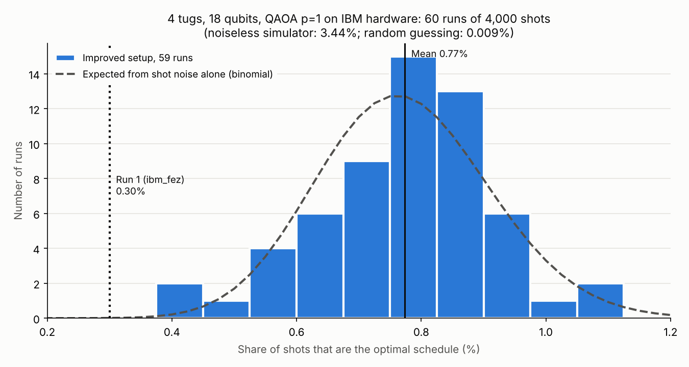

# IBM hardware runs: summary (60 runs, 2026-10-17/18)

All runs use the same instance: 4 tugs, 4 ships (2 contract, 2 spot), 12 kn wind, 18 qubits, and QAOA with p = 1.
Each run took 4,000 shots on Fran's IBM account (open plan), with every job capped at 180 s.
Run 1 used `scripts/run_hardware_experiment.py`. Runs 2 to 4 used `scripts/run_hardware_improved.py`, which picks the machine and
transpiler seed by estimated success probability. Runs 5 to 60 used `scripts/run_hardware_repeats.py` to repeat the exact run 2 to 4
circuit 56 times (same machine, seed, angles and physical qubits). Per-run details are in each folder's `run.json`, or in
`runs.csv` for runs 5 to 60.

## Headline (59 runs of the improved setup, runs 2 to 60)

- **Optimal shots: 0.774% ± 0.142%** (mean ± sample s.d., n = 59; standard error 0.019%). Median 0.775%, range 0.45% to 1.075%.
  Pooled: 1,826 optimal shots out of 236,000.
- **Valid shots: 1.70% ± 0.20%.** **Optimal among valid: 45.6% ± 6.0%**, against 47.8% on the noiseless simulator.
- **Every run found the optimum** (energy -9,000): 59 of 59, and 60 of 60 including run 1.
- The spread between runs matches shot noise alone (expected s.d. 0.139%, measured 0.142%; dispersion test p = 0.37), so the
  machine gave the same result every time within sampling error.
- Against run 1 (0.30% on ibm_fez): 2.6 times higher, z = 3.4 (p ≈ 0.0007). About 85 times uniform random guessing, and about
  22% of the noiseless simulator's 3.44%.
- Across all 60 runs, run 1 included: optimal 0.766% ± 0.154%, 1,838 optimal shots out of 240,000.

## Runs

| Run(s) | Folder | Machine | IBM job(s) | CZ gates | Optimal shots | Valid shots | Optimal among valid | Found optimum | IBM s per run |
|----:|--------|---------|---------|---------:|--------------:|------------:|--------------------:|:-------------:|----:|
| 1 | `2026-10-17T2350Z_ibm_fez_T4_w12` | ibm_fez | dba0j7vi0auc7391b3tg | 237 | 0.300% | 0.975% | 30.8% | yes | 3 |
| 2 | `2026-10-18T0005Z_ibm_kingston_T4_w12_improved` | ibm_kingston | dba0ql8c77vs738253fg | 204 | 0.675% | 1.475% | 45.8% | yes | 3 |
| 3 | `2026-10-18T0016Z_ibm_kingston_T4_w12_improved` | ibm_kingston | dba0veni0auc7391blug | 204 | 0.700% | 1.475% | 47.5% | yes | 3 |
| 4 | `2026-10-18T0019Z_ibm_kingston_T4_w12_improved` | ibm_kingston | dba1168c77vs73825bsg | 204 | 0.700% | 1.550% | 45.2% | yes | 3 |
| 5-60 | `2026-10-18T0105Z_ibm_kingston_T4_w12_improved_repeats` | ibm_kingston | 7 jobs, listed in its README | 204 | 0.778% ± 0.145% | 1.71% ± 0.20% | 45.5% ± 6.1% | 56 of 56 | 1.5 |

## Cost

Runs 1 to 4 took 3 s of IBM time each (one job per run). Runs 5 to 60 packed 8 runs into each job, which shares the per-job
overhead: 7 jobs of 12 s each, 84 s for 56 runs, or 1.5 s per run. Total for all 60 runs: 96 s. Fran's account has about 504 s left
this month.

## Reference values

- Noiseless simulator, same circuit: 3.46% optimal (exact, run-1 angles) and 3.44% (exact, run 2-60 angles). Valid shots are about
  7.4 to 8.1% when sampled.
- Uniform random guessing: 24 optimal states out of 2^18 = 0.0092%. Valid: 52 states = 0.0198%.
- Classical baseline: an exhaustive search (`dimod.ExactSolver`) over all 262,144 assignments returns the proven optimum
  (energy -9,000) on a laptop in seconds.

## Caveats

- Runs 2 to 60 moved to a different machine (ibm_kingston) from run 1. Part of the gain over run 1 is the better machine, not the
  compilation itself. The ESP breakdown is in run 2's README.
- Runs 5 to 60 all ran within about 2 minutes, under one calibration. They measure run-to-run spread, not drift over days.
  Runs 2 to 4, about an hour earlier, are consistent with them (z = 1.05, p = 0.29).
- Runs 2 to 4 alone suggested a very small spread (0.692% ± 0.014%). With 56 more runs the true spread is about 10 times larger,
  which is what 4,000 shots per run allow. Report the 59-run figures.

## Reproduce the statistics

`python scripts/summarize_hardware_runs.py results/hardware/2026-10-18T0105Z_ibm_kingston_T4_w12_improved_repeats` reads the saved
results (no credentials, no QPU time) and rewrites `stats.json` and the chart in that folder. The dispersion test is a chi-square
test of the per-run optimal counts against one shared binomial rate. The comparisons are pooled two-proportion z-tests.
